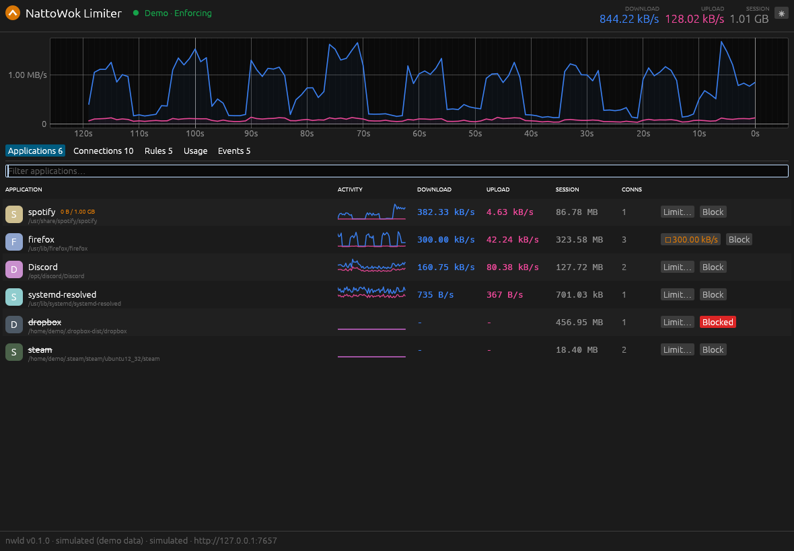

# NattoWok Limiter

**See which apps use your network, then control them.** NattoWok Limiter is a per-application network
monitor, firewall, bandwidth limiter and data-cap manager in the spirit of NetLimiter, NetBalancer
and GlassWire. The goal is to beat all three: it's open, scriptable, cross-platform, and honest
about what the OS can and can't do. Everything, from the kernel backends to the desktop app, is
written in Rust.



```
$ nwl top
total  down 2.28 MB/s  up 138.40 kB/s  (session 227.10 MB down, 14.20 MB up)

APP            DOWN          UP    SESSION  CONNS  POLICY   PATH
steam     1.00 MB/s  27.60 kB/s  175.00 MB      2  limited  /home/me/.steam/steam/ubuntu12_32/steam
firefox 906.00 kB/s  40.30 kB/s   14.00 MB      3           /usr/lib/firefox/firefox
spotify 236.00 kB/s   2.86 kB/s    5.09 MB      1           /usr/share/spotify/spotify
dropbox           -           -   28.10 MB      1  blocked  /home/me/.dropbox-dist/dropbox

$ nwl limit steam --down 1MB/s
$ nwl block dropbox
$ nwl block steam --days weekdays --from 09:00 --until 17:00
$ nwl quota spotify 2GB --per month
```

There are three front ends over the same daemon:

* **`nattowok`**, the native desktop app (Rust, egui): live traffic graph, per-app sparklines,
  one-click block and limit, a connection inspector with host names and RTT, a rules editor with
  schedules and network conditions (e.g. only on a phone hotspot), traffic history graphs from the
  last hour to the last 90 days with CSV export, data usage per day and an event log. It can start
  with your login, in the tray. Seven color themes (dark, light, Midnight, Forest, Sakura, Paper and
  high contrast), or match the system's light/dark setting.
* **The web dashboard**, served by the daemon at <http://127.0.0.1:7657>: the same app compiled to
  WebAssembly, so it has the same views, with nothing to install. (No tray, notifications or
  start-at-login there; those are the desktop app's.)
* **`nwl`**, the CLI, for scripts and terminals.

## What it does today

| Feature | Linux | Windows |
|---|---|---|
| Live per-app download/upload rates, session totals | ✅ every protocol incl. UDP/QUIC, exact per socket (eBPF; TCP-only fallback without root) | ✅ TCP (EStats, run as Administrator) |
| Traffic of short-lived sockets and processes (a 30 ms `getent`) still credited | ✅ eBPF | ❌ |
| Connection list: owner, state, rates, RTT, which rule applies | ✅ | ✅ (no RTT yet) |
| Block an app / network / port (in, out or both) | ✅ nftables | ✅ Windows Firewall |
| Bandwidth limits per app or network, download **and** upload | ✅ nftables policing | ⚠️ upload only (QoS policy) |
| Data quotas per day/week/month, warning at 80%, auto-block when reached | ✅ | ✅ |
| Schedules: rules active on chosen days and times (overnight windows too) | ✅ | ✅ |
| Network rules: apply only on metered networks (phone hotspots, mobile data) or on named networks; mark any network metered | ✅ via NetworkManager | ✅ connection cost (untested) |
| Host names of remote addresses (reverse DNS, cached, in the background) | ✅ | ✅ |
| "Who is this app talking to?": remote hosts per app with bytes, ports, protocols | ✅ | ✅ |
| Usage history per app per day (400 days) | ✅ | ✅ |
| Traffic history graphs, whole machine or one app: last hour to last 90 days, CSV export | ✅ | ✅ |
| "New app used the network" events | ✅ | ✅ |
| Traffic spike detection ("Dropbox is uploading at 8 MB/s, usually 12 kB/s") | ✅ | ✅ |
| Desktop notifications for new apps, spikes, quotas and enforcement problems, each switchable | ✅ | ✅ |
| Tray icon: live speed meter, pause/resume all rules, close to tray | ✅ StatusNotifierItem (no GTK) | ✅ native |
| Tray quick actions: block, unblock and limit the busiest apps from the menu | ✅ | ✅ |
| Buttons on notifications: "Block" a new app, "Block" or "Limit to 1 MB/s" on a spike | ✅ | ❌ (plain notifications) |
| Pause all rules with one click (traffic still counted; a restart resumes) | ✅ | ✅ |
| Edit rules in place, undo deletes (quota usage included), quota progress on each app and in the tray | ✅ | ✅ |
| Backup and restore of rules and network choices (replace or merge; drop the file on the window) | ✅ | ✅ |
| Presets: "Hotspot saver", "Calm background downloads", "Focus hours" (one click, removable) | ✅ | ✅ |
| Per-connection actions: close it, block its host for the app or for everyone | ✅ (sock_diag destroy) | ⚠️ close: IPv4 TCP only |
| Apps shown with their own name and icon ("Firefox Web Browser"), from installed `.desktop` entries | ✅ | ❌ (program name, letter icon) |
| Start with login, in the tray (opt-in, per user, no admin rights) | ✅ XDG autostart | ✅ (macOS: LaunchAgent) |
| Desktop app, web dashboard, REST API, live stream, CLI | ✅ | ✅ |
| Color themes (7, all checked for contrast), or follow the system's light/dark setting | ✅ | ✅ |

Rules are evaluated predictably (see [rules](#rules)), and when a backend can't express a rule exactly
it **reports a warning in the UI** instead of silently doing something else.

Status: early (v0.1). The Linux backend is tested end-to-end against a real kernel (see
`crates/nwl-platform/tests/linux_enforce.rs`: a 1 MB/s limit measures 1.00 MB/s steady state, block
and cleanup verified). The Windows backend compiles and its rule translation is unit tested, but it
hasn't been run on a Windows machine yet.

## Quick start

Requirements: Rust 1.80+. On Linux, enforcement needs root, `nft` (nftables) and cgroup v2, which any
current distribution has. Monitoring works without them.

```sh
# Optional: the web dashboard (the desktop app built for the browser, embedded in nwld)
rustup target add wasm32-unknown-unknown
cargo xtask web

cargo build --release

# Try it without touching your system: simulated apps that obey your rules.
./target/release/nwld --demo
./target/release/nattowok        # desktop app, or open http://127.0.0.1:7657

# Real system (Linux): monitor + enforce
sudo ./target/release/nwld
# Monitor only, never installs anything
./target/release/nwld --monitor-only
```

On Windows, run `nwld.exe` from an elevated prompt. Without elevation it still monitors connections,
but per-connection byte counters and enforcement need Administrator.

### Install on Linux

Packages contain the service, the CLI and the desktop app, plus the systemd unit (enabled and started
on install), the application-menu entry and icons. CI builds them on every push (download the
`linux-packages` artifact), and version tags attach them to a GitHub release. Or build them yourself:

```sh
cargo install cargo-deb cargo-generate-rpm
rustup target add wasm32-unknown-unknown && cargo xtask web   # the web dashboard
cargo build --release
cargo deb -p nwld --no-build            # target/debian/nattowok_*.deb
cargo generate-rpm -p crates/nwld       # target/generate-rpm/nattowok-*.rpm

sudo apt install ./target/debian/nattowok_*.deb           # Debian, Ubuntu, Mint, ...
sudo dnf install ./target/generate-rpm/nattowok-*.rpm     # Fedora, openSUSE, ...
```

Then start **NattoWok Limiter** from the application menu. Its icon sits in the tray, and closing the
window keeps it there. Without packages, copy the three binaries to `/usr/bin` and install
[`packaging/nwld.service`](packaging/nwld.service) and [`packaging/nattowok.desktop`](packaging/nattowok.desktop).
Windows builds (`nattowok-windows-x86_64.zip`) come from CI the same way.

### CLI

```
nwl status                       daemon and enforcement status
nwl top [-w]                     apps by current traffic (-w to watch)
nwl conns [--app PATH] [-a]      sockets with owner, rates, RTT, policy
nwl rules                        rules in evaluation order
nwl block APP [--direction in|out|both]          [WHEN]
nwl limit APP [--down RATE] [--up RATE]          [WHEN]
nwl quota APP SIZE [--per day|week|month] [--direction in|out|both] [WHEN]
      WHEN: --days mon,tue,…|weekdays|weekends  --from HH:MM --until HH:MM
            --metered | --unmetered  --network NAME
nwl add '<rule json>'            any rule, see below
nwl rm ID | enable ID | disable ID
nwl pause | resume               stop / restart all blocking and limiting
nwl network [metered|unmetered|auto]
                                 the current network; mark it metered or not (remembered)
nwl usage [--days N]             data used per app
nwl history [--range R] [--app PATH] [--csv]
                                 traffic over hour|day|week|month|quarter, as a chart or CSV
nwl remotes [--app PATH] [-n N]  remote hosts by traffic, per app or overall
nwl events
nwl preset [add|remove NAME]     ready-made rule sets (hotspot-saver, calm-downloads, focus-hours)
nwl export > backup.json          back up all rules and network choices
nwl import backup.json [--merge]  restore them (replace, or add what's missing)
```

Use `--json` for machine-readable output. `APP` is an executable name (`firefox`), a full path, or a glob
(`*/steam/*`). Rates accept `500kB/s`, `2MB/s`, `1.5MiB/s`, `20Mbit`, `10Mbps`; sizes accept `500MB`,
`20GB`, `1TiB`.

## Rules

Rules live in `rules.json` in the state directory (`/var/lib/nattowok` as root,
`~/.local/state/nattowok` otherwise, `%ProgramData%\NattoWokLimiter` on Windows). They are normally
managed through the UI, CLI or API.

```json
{
  "name": "Throttle Steam downloads",
  "enabled": true,
  "match": {
    "app": "steam",
    "protocol": "tcp",
    "remote": ["203.0.113.0/24", "2001:db8::/32"],
    "remote_ports": [443, "27000-27100"],
    "local_ports": [],
    "uid": 1000
  },
  "action": { "type": "limit", "download": "5MB/s", "upload": "1MB/s" },
  "schedule": { "days": ["mon", "tue", "wed", "thu", "fri"], "from": "09:00", "until": "17:00" },
  "network": { "metered": true }
}
```

Every `match` field is optional, and an empty match covers all traffic. Actions:

* `{"type": "allow"}` and `{"type": "block", "direction": "in" | "out" | "both"}` are **access rules**.
  They're checked top to bottom and the first match wins. No match means allow.
* `{"type": "limit", "download": RATE, "upload": RATE}` limits **always apply**, whatever the order and
  whatever access rule matched. Each limit is one shared budget for everything it matches, so several
  limits can stack (per app plus a global cap).
* `{"type": "quota", "limit": SIZE, "period": "day" | "week" | "month", "direction": ...}` counts the
  traffic it matches in local calendar periods. Once the cap is reached, that traffic is blocked until
  the next period.

A `schedule` makes a rule apply only inside a weekly window, in local time. Without `days` it applies
every day; without `from`/`until` it applies all day. A window that ends before it starts runs
overnight (`22:00`–`06:00`), and `days` then names the day it starts on. Outside its window a rule
behaves as if disabled: a scheduled quota doesn't count traffic and doesn't block.

A `network` condition makes a rule apply only on some networks: `{"metered": true}` (or `false`) and/or
`{"names": ["Pixel 8", "Office"]}`, matched against the primary connection's name (for Wi-Fi usually
its SSID), ignoring case. With both, both must hold. It's made for laptops on a phone hotspot:
`nwl block steam --metered` or `nwl quota dropbox 500MB --per day --metered` cost nothing at home.
On Linux, NetworkManager says whether the connection is metered and recognizes Android hotspots by
itself. On Windows, a network is metered when "Set as metered connection" is on in its settings, or
for mobile broadband. Wherever detection is missing or wrong, mark the network yourself, with
`nwl network metered` or the network menu in the app's header; the choice is remembered per network.
Off the matching networks a rule behaves as if disabled, like outside its schedule.

Localhost traffic is never counted or policed unless the daemon runs with `--include-loopback`. It
never reaches your ISP, and throttling it breaks local apps.

## How it works

```
             ┌───────────── nwld (daemon) ──────────────┐
  kernel ──▶ │ Monitor ─▶ Snapshot ─▶ Engine ─▶ Enforcer │ ──▶ kernel
             │            accounting, quotas, usage,     │
             │            events, rule store             │
             │                 │                         │
             │      REST + SSE API, web dashboard        │
             └─────────────────┬─────────────────────────┘
                               │ http://127.0.0.1:7657
         nattowok (desktop) ───┼─── browser ─── nwl (CLI)
```

* **`nwl-core`**: platform-independent data model, rule engine with schedules, accounting (rates,
  totals, history), quotas, size/rate parsing, and the API types shared by the daemon and every
  client. No I/O.
* **`nwl-platform`**: the OS backends, each a `Monitor` (observe) plus an `Enforcer` (apply rules):
  * **Linux**: sockets come from `NETLINK_SOCK_DIAG`, owners from `/proc/<pid>/fd`. Bytes come from
    three tiny eBPF programs on the root cgroup: one records which process (pid and name) created
    each socket, two add every packet's length to that socket's counters, keyed by the socket cookie
    `sock_diag` also reports. That counts UDP/QUIC too, and still credits sockets (and processes)
    that are gone before the next sample. The programs are assembled in Rust and loaded with the raw
    `bpf()` syscall, so there's no eBPF toolchain, BTF or extra dependency. They only observe
    (always "allow"), and are BPF links, which the kernel removes when the daemon exits, even on a
    crash. Without root, or with `--no-ebpf`, `tcp_info` gives TCP-only counters. To enforce,
    processes of targeted apps move into a child cgroup *inside their current cgroup*, so systemd
    units and desktop scopes still own them. One atomic nftables table then matches those sockets with
    `socket cgroupv2` and drops or polices their packets, using shared named `limit` objects.
  * **Windows**: sockets come from `GetExtendedTcpTable`/`GetExtendedUdpTable`, bytes from TCP
    extended statistics, and totals from `GetIfTable2`. Rules become Windows Firewall rules and QoS
    policies, installed by one PowerShell script and grouped under `NattoWokLimiter`.
  * **Simulated**: demo apps and traffic that obey the installed rules, for trying things out and
    developing the UI.
* **`nwld`**: the daemon. It runs the sampling loop, persists state, resolves host names in the
  background, and serves the API and dashboard. When it stops, it removes everything it installed.
* **`nwl-gui`** (binary `nattowok`): the desktop app, and compiled to WebAssembly, the web dashboard.
  It polls the API in the background (a thread on the desktop, a task on the page's event loop in
  the browser), so the UI never waits on the network, and table rows hold still while the pointer is
  over them so buttons don't move under the cursor.
* **`xtask`**: `cargo xtask web` builds the web dashboard (wasm-bindgen runs as a library, so no
  other tools are needed) into `crates/nwld/web/`, which the nwld build embeds. Without it, nwld's
  page explains how to add it.
* **`nwl`**: the CLI.

The API listens on loopback only. It rejects requests whose `Host` isn't a loopback name (to stop DNS
rebinding), and state-changing requests must carry an `X-NWL-Client` header (to stop CSRF from web
pages).

### API

| Method | Path | |
|---|---|---|
| GET | `/api/status` | version, backends, enforcement warnings/errors |
| GET | `/api/overview` | system rates, apps, quotas: what the stream sends each tick |
| GET | `/api/apps` | apps with history |
| GET | `/api/connections?app=PATH` | sockets with rates and policy decision |
| POST | `/api/connections/close` | close one connection (body: its `key`) |
| GET | `/api/system/history` | recent system-wide samples |
| GET/POST | `/api/rules` | list / create (`?index=N` inserts at a position) |
| PUT/DELETE | `/api/rules/{id}` | replace / delete |
| POST | `/api/rules/{id}/move` | `{"index": n}` reorder |
| POST | `/api/pause` | `{"paused": true}` pauses all rules, `false` resumes |
| GET | `/api/export` | backup of rules and network choices (JSON download) |
| POST | `/api/import?mode=replace\|merge` | restore a backup |
| GET | `/api/icon?app=PATH` | the app's icon (PNG or SVG), when its `.desktop` entry has one |
| GET/PUT | `/api/network` | the current network; `{"metered": true \| false \| null}` overrides detection for it |
| GET | `/api/quotas` | quota usage in the current period |
| GET | `/api/usage?days=N` | per-app bytes per day |
| GET | `/api/usage.csv?days=N` | the same as a CSV download |
| GET | `/api/history?range=R&app=PATH` | traffic per point over `hour`, `day`, `week`, `month` or `quarter`, plus top apps |
| GET | `/api/history.csv?range=R&app=PATH` | the same as a CSV download (one row per point and app) |
| GET | `/api/remotes?app=PATH&limit=N` | remote hosts by traffic this session, for one app or all |
| GET | `/api/events?after=ID` | event log |
| GET | `/api/stream` | Server-Sent Events, one `overview` per tick |

## Known limitations

* **Linux**: per-app counts of every protocol need root (eBPF). Without it they cover TCP only, and
  the UI says so. With eBPF, counted bytes are IP packet sizes (payload plus headers, including
  retransmissions), which is what an ISP meters; the TCP-only fallback counts payload. A new process
  of a limited app is classified within one tick (1 s by default). Limits police (drop
  above the rate) instead of queueing. That works well for TCP, but the first second of a transfer can
  exceed the limit, because the kernel's bucket holds one second of rate.
* **Windows**: no download limits yet (they need a packet driver). Windows Firewall applies block
  rules before allow rules, so an `allow` can't carve an exception out of a later `block`. Both cases
  show as warnings. Byte counters cover TCP only.
* **macOS**: not supported yet (`--demo` works).

## Roadmap

See [docs/ROADMAP.md](docs/ROADMAP.md). The big ones: enforcement in eBPF (instant classification,
true shaping and priorities), a Windows packet driver for download limits and UDP counts,
ask-on-first-connection firewall prompts, domain rules from DNS answers, and network profiles.

## Development

```sh
cargo test                       # unit + API tests, no privileges needed
sudo -E NWL_E2E=1 cargo test -p nwl-platform --test linux_enforce      # real-kernel enforcement test
cargo clippy --all-targets
cargo clippy --all-targets --target x86_64-pc-windows-msvc            # check the Windows backend from Linux
cargo run -p nwld -- --demo      # daemon with simulated traffic
cargo run -p nwl-gui             # desktop app
cargo clippy -p nwl-gui --target wasm32-unknown-unknown               # check the web build
cargo xtask web --dev            # build the web dashboard quickly, then rebuild nwld
```

The desktop app needs no system libraries to build. At runtime on Linux it uses the usual desktop
libraries (OpenGL, `libxkbcommon`, X11 or Wayland), which every desktop distribution ships.

## License

NattoWokLimiter is free software: you can redistribute it and/or modify it under the terms of the
[GNU General Public License](LICENSE), version 3 or (at your option) any later version
(`GPL-3.0-or-later`). It comes with no warranty.

This is a copyleft license: anyone who distributes NattoWokLimiter, changed or not, must pass on the
same freedoms, which includes offering the source code. Contributions are accepted under the same
license.

The eBPF programs nwld loads into the kernel are part of this code and declare a GPL license to the
kernel. Third-party crates keep their own licenses, all compatible with the GPL (mostly MIT and
Apache-2.0); the bundled egui fonts are under the SIL Open Font License and the Ubuntu Font Licence.
