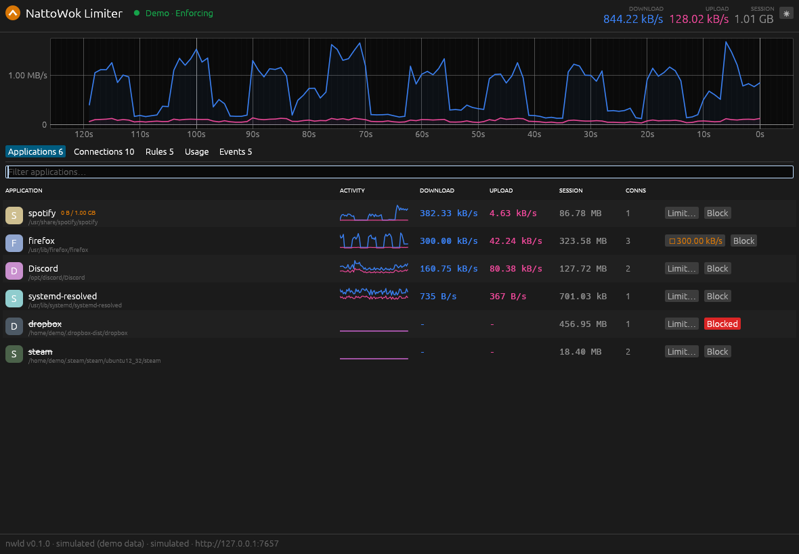
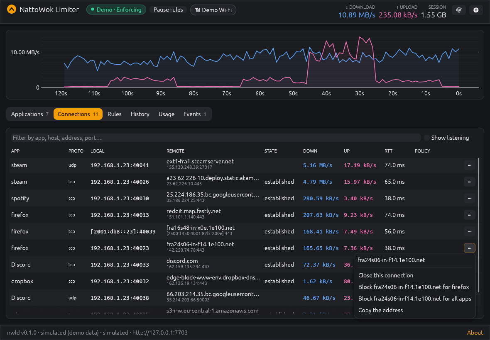
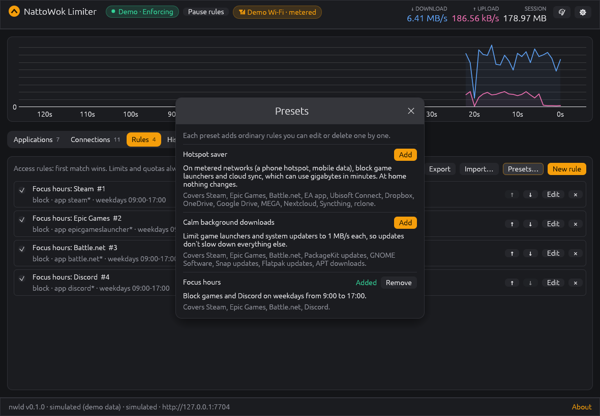
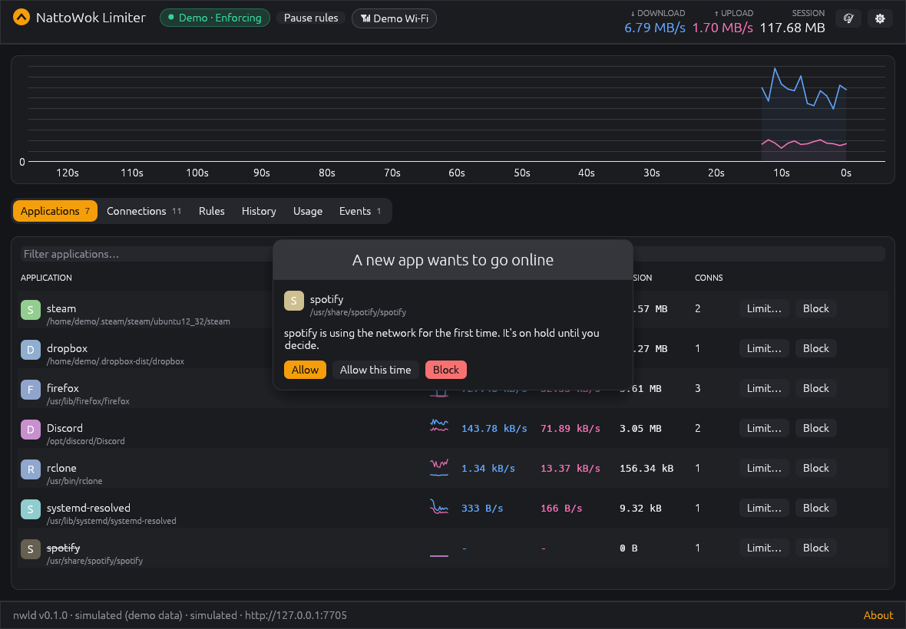
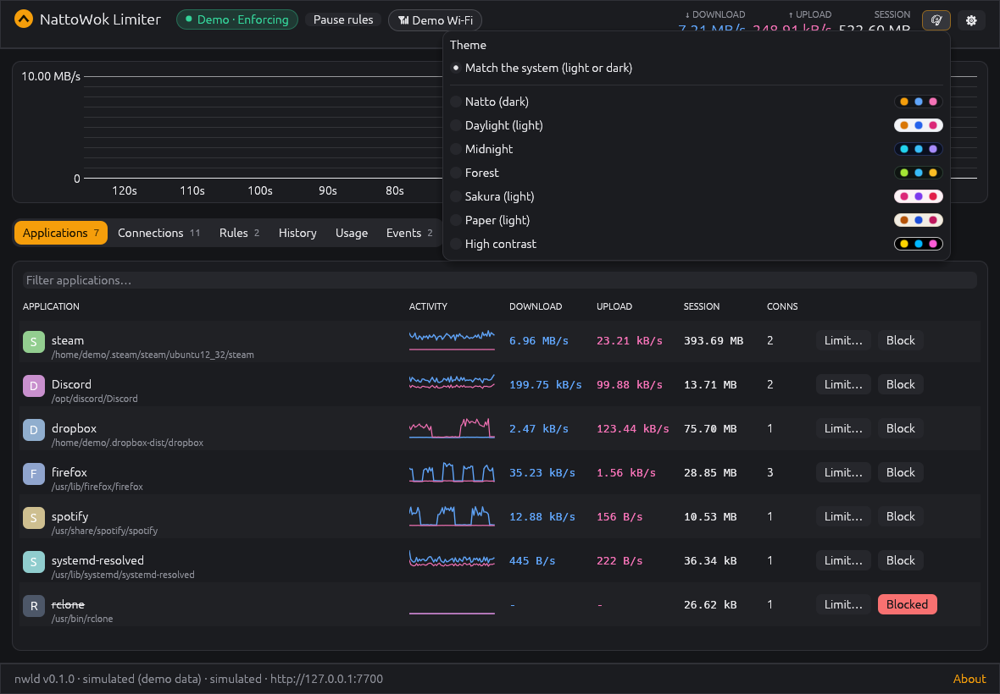

# Getting started with NattoWok Limiter

NattoWok Limiter shows which apps use your network and lets you block them, slow them down or cap
how much data they use. This guide is for using it; the [README](../README.md) has the technical
details.

It has two parts: a **background service** (`nwld`) that watches the network and applies your
rules, and the **app** (`nattowok`) where you see everything and make changes. The same app also
runs in your browser at <http://127.0.0.1:7657>, and there's a command line tool (`nwl`).

## Install

**Windows:** run `nattowok-setup-x86_64.exe` and follow the steps. It installs the service, which
starts right away and with Windows, and adds NattoWok Limiter to the Start menu. Uninstalling
removes everything.

**Linux (Debian, Ubuntu, Mint…):** `sudo apt install ./nattowok_*.deb`
**Linux (Fedora, openSUSE…):** `sudo dnf install ./nattowok-*.rpm`

The service starts on its own. Open **NattoWok Limiter** from your applications menu.

**Just looking?** Run `nwld --demo` and then the app: it shows made-up apps and traffic, and nothing
on your computer is changed.

## A quick tour

* **The header** shows whether rules are being applied, the network you're on (click it to mark it
  metered), and the total download and upload speed. **Pause rules** turns off all blocking and
  limiting until you resume.
* **The graph** shows the last two minutes of traffic: blue is download, pink is upload.
* **Applications** lists every app using the network, busiest first. Click an app to see which
  servers it talks to.
* **Connections** lists every connection, with the website or server it goes to, its country and
  owner (once you add a free location database, see below).
* **Rules** holds what you've blocked, limited or capped.
* **History** shows traffic over the last hour up to the last 90 days, for everything or one app.
* **Usage** shows data used per app per day.
* **Events** lists what happened: new apps, quotas reached, rule changes.

## Everyday things

**Block an app:** on the Applications tab, click **Block** next to it. Click **Blocked** to unblock.

**Slow an app down:** click **Limit…**, enter a speed like `1MB/s` for download and/or upload.

**Cap how much data an app uses:** Rules → **New rule** → Action **Data quota**, e.g. `5GB` per
month. When it's used up, the app is blocked until the next month. Each app's row shows how much
of its quota is used.

**Block a website or server:** on the Connections tab, click **⋯** on a connection and choose
**Block … for this app** or **for all apps**. To block a whole domain (like `doubleclick.net`),
make a rule with it in the **Domains** field.

**Close a connection:** **⋯** → **Close this connection**. The app usually reconnects; block it to
keep it out.

**Undo:** deleting or unblocking shows an **Undo** button for a few seconds.

**Edit a rule:** Rules → **Edit** on the rule.

## Ready-made rule sets

Rules → **Presets…**

* **Hotspot saver:** on a metered network (your phone's hotspot, mobile data), game launchers and
  cloud sync are blocked, so they don't eat your data plan. At home nothing changes.
* **Calm background downloads:** game launchers and system updates are limited to 1 MB/s each.
* **Focus hours:** games and Discord are blocked on weekdays 9:00–17:00.

You can change or delete their rules afterwards, or remove a whole preset again.

## On a phone hotspot or mobile data

Rules can apply **only on metered networks**: when making a rule, set **Network** to **Metered
only**. Linux usually recognizes phone hotspots as metered by itself; on Windows, turn on "Set as
metered connection" in the network's settings. If it's detected wrong, click the network name in the
header and choose **Metered** or **Not metered**; the app remembers this per network.

## Be asked about new apps

Rules → tick **Ask before new apps use the network**. From then on, when a program goes online for
the first time, it's held until you choose **Allow**, **Allow this time** or **Block**.

It is noticed within a second, so its very first bit of traffic can get through before you're
asked.

## Notifications, start with login, themes

* **⚙** (desktop app): which notifications you get (new apps, unusual traffic spikes, quotas, a
  changed program…), and starting the app when you log in.
* **🎨**: seven color themes, or follow your system's light/dark setting.

## Countries and network owners (optional)

To see which country a server is in and who runs it ("DE · Google LLC"), install a free location
database:

1. Download **IP to Country Lite** and **IP to ASN Lite** in MMDB format from
   <https://db-ip.com/db/lite.php> (free, no account), or GeoLite2 Country and ASN from
   <https://www.maxmind.com> (free account).
2. Unpack the `.mmdb` files into the service's data folder, in a `geoip` folder:
   * Windows: `C:\ProgramData\NattoWokLimiter\geoip\`
   * Linux: `/var/lib/nattowok/geoip/` (or `/var/lib/GeoIP/`)
3. Restart the service (Windows: restart "NattoWok Limiter" in Services; Linux:
   `sudo systemctl restart nwld`).

## Keeping your rules

Rules → **Export** saves your rules (and which networks you marked metered) to a file in Downloads.
**Import…** restores it: drop the file on the window, then choose to replace your rules or add the
ones you don't have.

## If something isn't right

* **"Can't reach the NattoWok service":** the service isn't running. On Linux click **Start the
  service** (it asks for your password) or run `sudo systemctl start nwld`. On Windows, start
  "NattoWok Limiter" in Services, or reinstall.
* **"Monitor only" in the header:** the service can see traffic but not apply rules, usually because
  it doesn't run with administrator/root rights. The installer and packages set this up; if you run
  `nwld` yourself, use `sudo` (Linux) or an Administrator prompt (Windows).
* **Download limits don't work on Windows:** Windows only lets programs limit uploads without a
  special driver. Blocking and data quotas work.
* **An app shows as a program name with a letter instead of its icon:** it has no installed
  description the service can find (common for command-line tools).
* Anything else: open an issue with what happened and the output of `nwl status`; see
  [CONTRIBUTING](../CONTRIBUTING.md).
